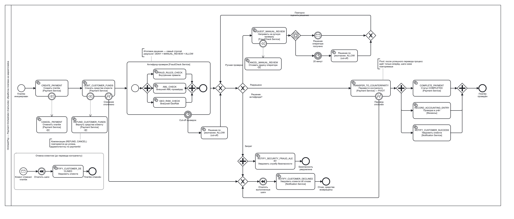

# Задание 4. BPMN

Исходник для Camunda Modeler - payment-process.bpmn.

- Антифрод-проверки (правила, AML, GeoRisk) идут параллельно в подпроцессе, на нем таймер cut-off.
- Ручная проверка: event-based gateway - ждем либо решение оператора, либо 20 минут. После cut-off решение по умолчанию ALLOW.
- Pivot - TRANSFER_TO_COUNTERPARTY. До него у шагов есть компенсации (CANCEL_PAYMENT, REFUND_CUSTOMER_FUNDS, CANCEL_MANUAL_REVIEW), после него шаги только повторяемые.
- При запрете / ошибке списания / отказе перевода вызывается компенсация выполненных шагов, деньги возвращаются автоматически.
- Отмена клиентом - отдельный event subprocess, работает только до перевода контрагенту.
